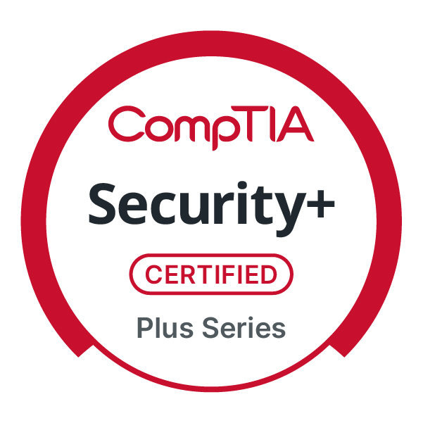

# Keith Sistrunk — Network Security Engineer 🛡️

> Palo Alto (PAN-OS) | FortiGate | Cisco | Zscaler | Azure Hybrid Connectivity | Microsoft Sentinel

Network security engineer with 15+ years in IT across Cisco, Palo Alto, FortiGate, and Zscaler environments. Firewall policy, site-to-site and remote-access VPN, BGP, and log integration — plus vulnerability management and AI security work.

**Core skills:** App-ID / security policy · NAT · SSL decryption · IPsec (IKEv2) · GlobalProtect · BGP · DMVPN · PAN-OS XML API (Python) · Azure VPN Gateway · Sentinel / KQL · STIG hardening · Tenable

## 🎓 Certifications

**CompTIA Security+** (SY0-701) · valid through Sep 2027 · [verify](https://verify.comptia.org)

---

## 🔥 Firewall & Network Security

### [PA-440 to Azure: Firewall, VPN, BGP and Sentinel](https://github.com/KeithSistrunk/palo-alto-to-azure)

Physical PA-440 connected to an Azure hub. Seven labs, each with the build, validation, deliberate break-and-fix tests, and real log evidence.

- ✅ App-ID policy from default deny — zones, DHCP, source NAT, routing
- ✅ SSL forward proxy decryption — forward trust/untrust CAs, profiles, exclusions
- ✅ Site-to-site IKEv2 VPN to Azure — NAT-T behind NAT, route-based tunnel, Phase 1/2 troubleshooting
- ✅ eBGP inside IPsec — floating static backup, inbound import filter, break-and-fix
- ✅ GlobalProtect remote access — portal, gateway, certificates, split tunnel
- ✅ PA-440 logs to Microsoft Sentinel — CEF over IPsec, Azure Monitor Agent, KQL, analytics rule tuning
- ✅ PAN-OS XML API automation — read-only rule audit, scripted change with partial commit, least-privilege keys

---

## 🔒 Hardening & Compliance

### [STIG Remediation Automation](https://github.com/KeithSistrunk/Automation)

PowerShell automation that hardens Windows endpoints against DISA STIG baselines — driving a single host from 205 open findings down to 23 in one pass.

- ✅ Automated STIG remediation — 205 → 23 findings (~89% reduction)
- ✅ PowerShell-based and repeatable across hosts
- ✅ Maps to RMF / continuous-monitoring workflows (hardening baselines, POA&M)

### 🔒 Cisco IOS Hardening Checker

Read-only Python auditor that flags CMMC / STIG-style misconfigurations in a Cisco IOS / IOS-XE config — weak password encryption, missing session timeouts, plaintext management (Telnet/HTTP), absent logging, and default SNMP communities — with line-referenced findings and remediation guidance.

- ✅ 12 hardening controls checked, each with PASS / WARN / FAIL and a fix
- ✅ Secrets auto-redacted in output; non-zero exit code for CI gating
- ✅ Stdlib only, no device connection — parses an offline config export

---

## 🔍 Vulnerability Management

### [Vulnerability Management Program](https://github.com/KeithSistrunk/Vulnerability-Management-Program)

End-to-end VM pipeline built against a live Tenable enterprise instance. CVE ingestion, CVSS/EPSS/KEV risk scoring, automated remediation package generation, Excel dashboard output.

- ✅ Live Tenable API ingestion — no manual CSV exports
- ✅ Threat-intel enrichment — CISA KEV · EPSS · NVD on every CVE
- ✅ Explainable weighted risk scoring — every point auditable
- ✅ Severity-based SLA assignment — Critical 15d · High 30d · Medium 60d · Low 90d
- ✅ Secrets in env vars — least-privilege, read-only Tenable key
- ✅ Real scan data gitignored — public demo runs on synthetic data only

---

## 🤖 AI Security Projects

### [Honeypot — LLM Deception Defense System](https://github.com/KeithSistrunk/honeypot)

An LLM honeypot that detects hostile prompts and silently routes attackers into an isolated shadow environment while real users reach the real model untouched. Built on a suspicion-scoring gate; tested by pointing my own red-team tool at it.

- ✅ 91% attack catch rate, 0% false positives — measured against a live red-team run
- ✅ Session-level rerouting — a user who turns hostile mid-session is flipped to shadow permanently
- ✅ Tiered scoring — canary triggers instant-shadow, injection/priv-esc accumulate, weak signals never fire alone
- ✅ Live dashboard — two-tab console (attack + monitor) with real-time flow diagram and session cards
- ✅ OWASP LLM Top 10 (2025) assessed — 2 Medium findings hardened, regression-tested

---

### [RedOwl — Agentic LLM Red-Team CLI](https://github.com/KeithSistrunk/redowl)

An agentic red-team tool that autonomously attacks LLM chatbots to find where they break, using a two-LLM design — a reasoning model picks and generates attacks, a target model gets tested, an evaluator judges the result.

- ✅ Three-arm experiment — measured fixed vs AI-generated attacks: 45% → 31% → 11% success, showing more model freedom produced fewer successful attacks
- ✅ Two-LLM architecture — reasoning, target, and evaluator roles separated
- ✅ Honest error bars — findings reported with run-to-run variance, not cherry-picked
- ✅ Feeds the Honeypot — its attack pool became the honeypot's detection signatures

---

### [AuditIQ — CMMC Level 1 RAG Evidence Assistant](https://github.com/KeithSistrunk/auditiq)

AI-powered compliance evidence assistant for CMMC Level 1 self-assessment preparation. Uses RAG (LlamaIndex + OpenAI) to let teams query audit evidence in plain English, identify control gaps across all 17 practices, and generate audit-ready outputs for human review.

- ✅ Full OWASP LLM Top 10 coverage — all 10 risks mitigated
- ✅ Prompt injection detection — 22 known attack patterns blocked
- ✅ File integrity monitoring via SHA-256 hashing
- ✅ Persistent audit logging via Supabase
- ✅ CI/CD via GitHub → Streamlit Cloud

---

### 🎯 RedScope AI — OWASP Web Security Red Team Tool

AI-powered red team application built to audit web applications against the OWASP Top 10. Used to identify and confirm a live XSS vulnerability (OWASP A03:2021) in AuditIQ production — demonstrating a complete offensive/defensive AI security workflow. Built as a class project in an AI security engineering program.

- ✅ Found a live XSS in production — real finding against AuditIQ, not a lab target
- ✅ Agentic AI red-team scanner — LLM guides testing, explains findings, organizes results
- ✅ OWASP-focused coverage — XSS · SQLi · IDOR / access control · misconfig · exposed files · security headers
- ✅ Evidence-based reporting — Markdown / PDF / HTML output for manual validation
- ✅ Authorized-targets-only by design — scope-consent flow, non-destructive checks
- ✅ Python stack — security checks + HTTP libraries, Streamlit dashboard, LLM via API

---

## 🕵️ Threat Hunting & Security Operations

### [Threat Hunt: Unauthorized Tor Usage](https://github.com/KeithSistrunk/threat-hunting-scenario-tor)

End-to-end threat hunt detecting unauthorized Tor Browser use on a corporate endpoint, built on a Microsoft Defender for Endpoint cyber range. Reconstructed the full activity chain — download, silent install, execution, and outbound connections to known Tor entry nodes — directly from raw EDR telemetry.

- ✅ Hunted across `DeviceFileEvents`, `DeviceProcessEvents`, and `DeviceNetworkEvents` with custom KQL
- ✅ Reconstructed the timeline — installer download → silent install → browser launch → Tor node connections
- ✅ Surfaced concrete IoCs — portable Tor installer, `tor.exe`, `tor-shopping-list.txt`, known Tor ports
- ✅ Delivered an audit-ready hunt report with evidence and a notify-management workflow

---

## 🔗 Connect

